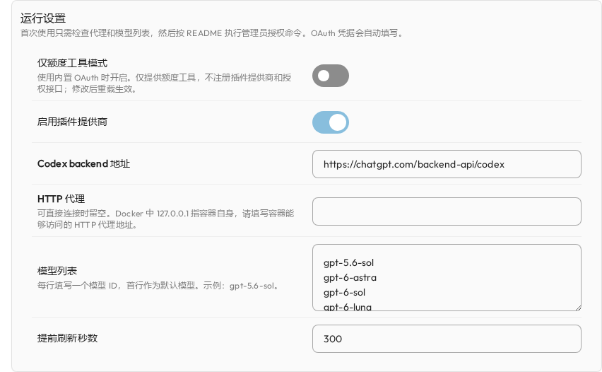
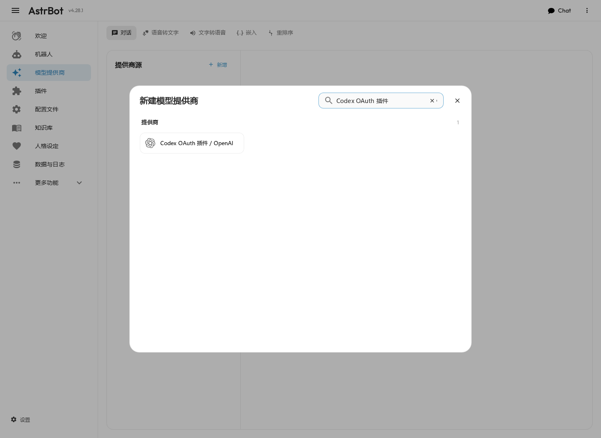
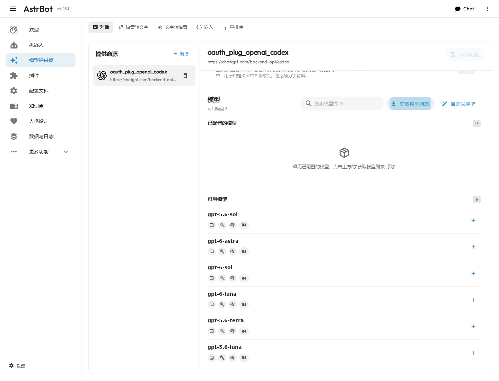
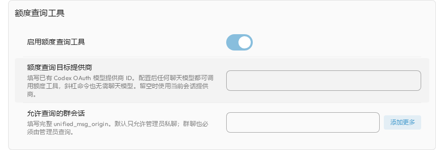

# AstrBot Codex OAuth 插件

使用 OpenAI 账号授权，在 AstrBot 中调用 Codex 模型。完成一次绑定后，可为多个模型添加提供商，共用插件保存的授权信息，无需逐个填写 API Key。

支持聊天、流式回复、图片理解、工具调用、推理强度设置、联网搜索，以及供其他插件调用的图片生成、音频转录和实时音频接口。

**快速开始：安装插件 → 完成账号授权 → 添加模型 → 测试。**

截图来自 AstrBot 4.28.1 的真实界面，使用脱敏示例配置；不同版本的界面和模型列表可能略有差异。

## 1. 安装插件

在 AstrBot 的插件管理页面，使用仓库地址安装并启用：

```text
https://github.com/RhoninSeiei/astrbot_plugin_codex_oauth_plug
```

打开插件配置。通常只需要检查两项，其余保持默认：

| 配置项 | 填写方式 |
| --- | --- |
| HTTP 代理 | AstrBot 能直接访问服务时留空；需要代理时填写 AstrBot 所在环境能访问的 HTTP 代理地址。 |
| 模型列表 | 保留默认列表即可；每行一个模型 ID，可增删。首行是连接测试的默认模型。 |

Docker 中的 `127.0.0.1` 指容器自身。代理运行在另一台电脑或宿主机时，应使用容器能够访问的地址。

“OAuth 凭据”由授权流程自动填写，无需手动复制 Access token、Refresh token 或账号 ID。

在插件卡片上点击齿轮打开配置，找到“运行设置”。作为独立 OAuth 提供商使用时，保持“仅额度工具模式”关闭、“启用插件提供商”开启。



## 2. 完成账号授权

使用 AstrBot 管理员账号，建议在与机器人的私聊中操作。以下示例使用默认唤醒前缀 `/`；如果修改过前缀，请相应替换。

1. 发送：

   ```text
   /codex_oauth_start
   ```

2. 打开机器人返回的链接，在浏览器中登录 OpenAI 账号并完成授权。
3. 浏览器跳转后，复制地址栏中的**完整回调地址**。回调地址可能以 `http://localhost:1455/` 开头；远程部署时页面打不开也可复制地址，只要其中包含 `code` 和 `state`。
4. 将回调地址放在命令后发送：

   ```text
   /codex_oauth_complete 完整回调地址
   ```

5. 看到绑定成功后，发送：

   ```text
   /codex_oauth_test
   ```

测试成功会返回模型名称和耗时。回调地址及凭据包含敏感信息，请勿发布到群聊、截图或公开问题单。

<details>
<summary>其他授权输入方式</summary>

`codex_oauth_complete` 也接受 `code#state` 或 Codex `auth.json` 的 JSON 内容。授权码方式需要先在当前插件运行期间执行 `codex_oauth_start`；JSON 导入不需要先创建授权流程。

优先使用独立授权流程。不要让独立插件和其他运行中的服务同时刷新同一份 Refresh token，否则可能因令牌轮换导致授权失效。

</details>

## 3. 添加模型提供商

在模型提供商页面点击“新增”，搜索 `Codex OAuth 插件`，选择 **Codex OAuth 插件 / OpenAI**。授权信息由插件提供，模板中的 Key 占位值保持原样即可。



点击“保存并获取模型”，在目标模型右侧点击 `+` 添加并启用，再将其选为当前会话或默认模型。已有提供商可点击“获取模型列表”刷新。列表来自插件配置，账号能否调用模型以 `codex_oauth_test` 的结果为准。



| 模型 ID | 可用推理强度 |
| --- | --- |
| `gpt-6.1-sol` | `low`、`medium`、`high`、`xhigh`、`max` |
| `gpt-6-astra` | `low`、`medium`、`high`、`xhigh`、`max` |
| `gpt-6-sol` | `none`、`low`、`medium`、`high`、`xhigh`、`max` |
| `gpt-6-luna` | 同上 |
| `gpt-5.6-sol` | `none`、`low`、`medium`、`high`、`xhigh`、`max` |
| `gpt-5.6-terra` | 同上 |
| `gpt-5.6-luna` | 同上 |

模型是否实际可用取决于账号权限和服务端支持。旧模型及自定义模型 ID 仍可填写。

从旧版本升级时，已有模型列表保持不变。如需使用 `gpt-6.1-sol`，在插件配置的“模型列表”中增加一行，再到模型提供商页面获取模型列表。

已有内建 OAuth 时，两者分别管理授权。如果内建功能已满足需求，无需安装本插件。

## 4. 常用设置

### 推理强度

在模型提供商的自定义请求体 `custom_extra_body` 中填写，例如：

```json
{
  "reasoning": {
    "effort": "high"
  }
}
```

不填写时由服务端决定默认强度。`off` 按 `none` 处理，GPT-6.1 Sol 和 GPT-6 Astra 不接受 `none`；单次模型请求不接受 `ultra`。

### 联网搜索

在插件高级设置中选择联网搜索模式：

| 模式 | 行为 |
| --- | --- |
| `disabled` | 默认关闭内建搜索。 |
| `cached` | 允许使用缓存搜索结果。 |
| `live` | 允许实时访问网页。 |

可选填写允许搜索的域名列表，例如 `example.com`，不要填写完整 URL。配置用于插件提供商，具体提供商和单次调用的覆盖方式见[开发接口](docs/API.md)。

### 图片与音频

图片生成和参考图编辑通过其他插件调用 `generate_image()` 使用，不会自动增加生图聊天命令。

高级设置增加“实验性图片模型”，可请求 `gpt-image-2`、`gpt-image-2.5-flare` 或 `gpt-image-2.5-sunburst`，留空使用服务端默认值。该选项仅影响图片工具，不改变主控聊天模型；服务端可能忽略指定值，不能据此确认实际采用的图片模型。

音频转录默认关闭。只有账号具备转录权限时才启用；也可继续使用 AstrBot 自身的语音转文字提供商。实时音频接口供插件开发者使用，需要调用方处理 WebRTC 音频连接，不是开箱即用的语音聊天页面。

## 常见问题

| 现象 | 处理方法 |
| --- | --- |
| 找不到插件提供商类型 | 确认插件已启用，且配置中的“启用插件提供商”开启；刷新模型提供商页面。 |
| 授权回调页面打不开 | 复制地址栏完整 URL，通过 `codex_oauth_complete` 提交，无需开放宿主机的 1455 端口。 |
| 提示流程未开始、已过期或 state 不匹配 | 重新执行 `codex_oauth_start`，使用这次生成的授权链接及回调地址；授权中途不要重载插件。 |
| 提示尚未绑定或缺少账号 ID | 重新完成完整授权流程，不要只填 Access token。 |
| 连接超时或代理连接失败 | 检查 AstrBot 容器内的网络和代理地址，确认代理允许来自容器的连接。 |
| 令牌刷新失败或 `refresh_token_reused` | 重新授权，并避免多个服务共同刷新同一份授权凭据。 |
| 模型测试成功，聊天仍使用其他模型 | 在 AstrBot 会话或默认模型设置中选择刚添加的插件提供商。 |

## Codex 额度工具

`/codex_oauth_usage` 是直接查询命令，不调用 LLM。`codex_oauth_usage` 同时也是供模型调用的只读工具，询问“Codex 额度还剩多少”可触发工具调用。两种入口均返回已用比例、剩余比例、窗口长度、重置时间和采集时间。

在“额度查询目标提供商”中填入模型页面实际保存的 Codex OAuth 提供商 ID，即可固定查询该账号；留空则查询当前会话使用的 OAuth 提供商。支持内建和插件 OAuth。固定目标后，其他支持工具调用的聊天模型也能查询该账号额度。

仅需为内建 OAuth 补充额度查询时，开启“仅额度工具模式”并重载插件。此模式沿用内建提供商的授权，不提供插件授权和聊天功能。

`usage.enabled` 控制命令与工具查询；默认仅管理员私聊可用。群聊需要在 `usage.group_allowlist` 填入完整 `unified_msg_origin`，并且查询者仍须为管理员。



查询结果缓存 60 秒，不消耗模型推理额度。缺失字段表示未知，不能据此换算剩余请求次数。

## 命令速查

| 管理员命令 | 用途 |
| --- | --- |
| `/codex_oauth_usage` | 直接查询额度，不调用 LLM。 |
| `/codex_oauth_start` | 获取新的授权链接。 |
| `/codex_oauth_complete 授权输入` | 提交回调地址、`code#state` 或 JSON 凭据。 |
| `/codex_oauth_test` | 测试默认模型。 |
| `/codex_oauth_test gpt-6-astra` | 测试指定模型。 |
| `/codex_oauth_refresh` | 手动刷新授权；正常调用会自动刷新。 |

## 开发与版本

- [开发接口：聊天、推理、搜索、生图、音频和 Web API](docs/API.md)
- [更新日志](CHANGELOG.md)
- [AGPL-3.0 许可证](LICENSE)
- [代码来源与原 MIT 版权声明](NOTICE.md)

本项目为非官方集成。使用前请确认账号授权和使用方式符合相关服务条款；请自行保管凭据。服务可用性、账号限制和配额由服务提供方决定。
