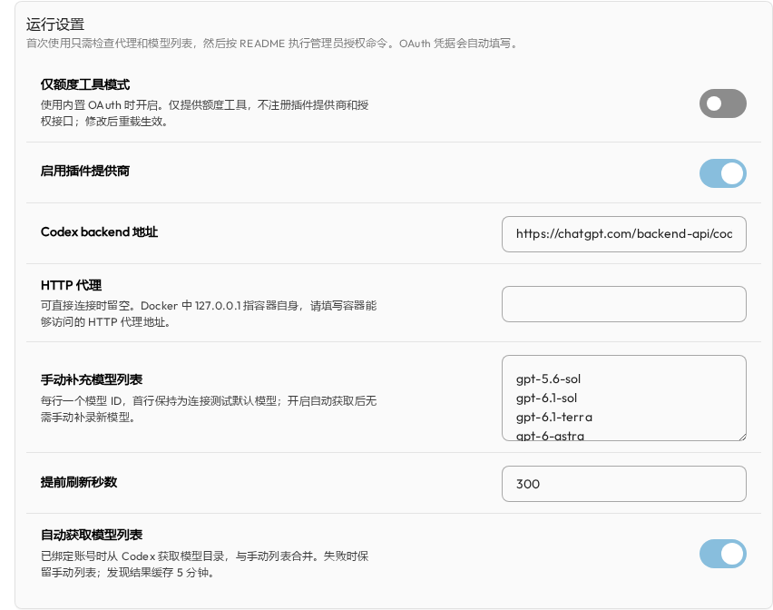
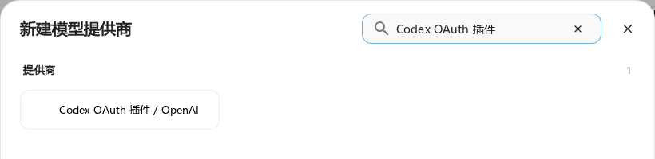
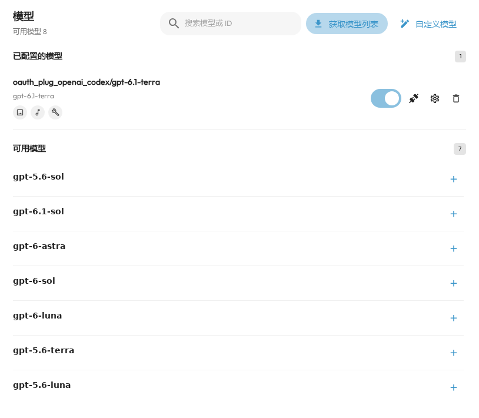
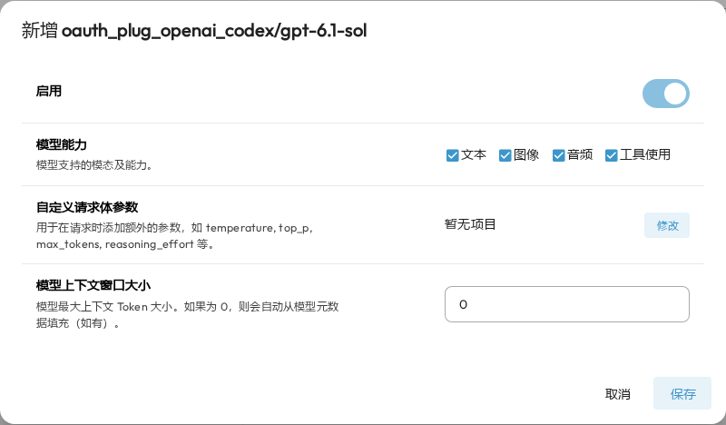
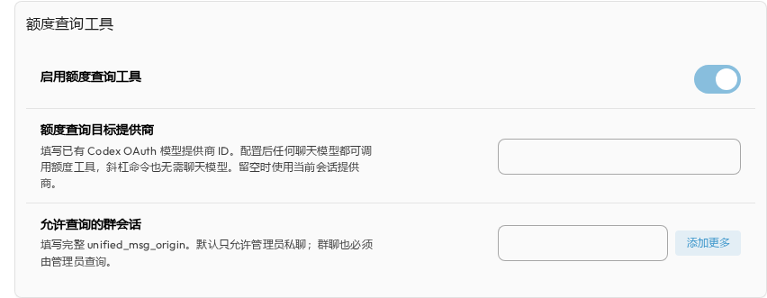

# AstrBot Codex OAuth 插件

使用 OpenAI 账号授权，在 AstrBot 中调用 Codex 模型。完成一次绑定后，可为多个模型添加提供商，共用插件保存的授权信息，无需逐个填写 API Key。

支持聊天、流式回复、图片理解、工具调用、推理强度设置、联网搜索，以及供其他插件调用的图片生成、音频转录和实时音频接口。

**快速开始：安装插件 → 完成账号授权 → 获取并添加模型 → 选择会话模型。**

截图来自 AstrBot 4.29.4 与本插件 v0.6.0 的隔离演示实例，使用空白凭据和示例配置。实际模型列表以账号权限为准。

## 1. 安装插件

在 AstrBot 的插件管理页面，使用仓库地址安装并启用：

```text
https://github.com/RhoninSeiei/astrbot_plugin_codex_oauth_plug
```

打开插件配置，检查代理并保持自动模型发现开启，其余通常可以使用默认值：

| 配置项 | 填写方式 |
| --- | --- |
| HTTP 代理 | AstrBot 能直接访问服务时留空；需要代理时填写 AstrBot 所在环境能访问的 HTTP 代理地址。 |
| 自动获取模型列表 | 默认开启。完成授权后，在模型提供商页面点击“获取模型列表”，自动读取账号目录。 |
| 手动补充模型列表 | 一般无需修改。用于补充自定义模型，以及自动获取失败时回退；首行仍是连接测试的默认模型。 |

Docker 中的 `127.0.0.1` 指容器自身。代理运行在另一台电脑或宿主机时，应使用容器能够访问的地址。

“OAuth 凭据”由授权流程自动填写，无需手动复制 Access token、Refresh token 或账号 ID。

在插件卡片上点击齿轮打开配置，找到“运行设置”。作为独立 OAuth 提供商使用时，保持“仅额度工具模式”关闭、“启用插件提供商”开启。



## 2. 完成账号授权

使用 AstrBot 管理员账号，建议在与机器人的私聊中操作。以下示例使用默认唤醒前缀 `/`；如果修改过前缀，请相应替换。

1. 发送：

   ```text
   /codex_oauth_start
   ```

2. 打开机器人返回的链接，在浏览器中登录 OpenAI 账号并完成授权。
3. 浏览器跳转后，复制地址栏中的**完整回调地址**。回调地址可能以 `http://localhost:1455/` 开头；远程部署时页面打不开也可复制地址，只要其中包含 `code` 和 `state`。
4. 将回调地址放在命令后发送：

   ```text
   /codex_oauth_complete 完整回调地址
   ```

5. 看到绑定成功后，发送：

   ```text
   /codex_oauth_test
   ```

测试成功会返回模型名称和耗时。回调地址及凭据包含敏感信息，请勿发布到群聊、截图或公开问题单。

<details>
<summary>其他授权输入方式</summary>

`codex_oauth_complete` 也接受 `code#state` 或 Codex `auth.json` 的 JSON 内容。授权码方式需要先在当前插件运行期间执行 `codex_oauth_start`；JSON 导入不需要先创建授权流程。

优先使用独立授权流程。不要让独立插件和其他运行中的服务同时刷新同一份 Refresh token，否则可能因令牌轮换导致授权失效。

</details>

## 3. 添加模型提供商

在模型提供商页面点击“新增”，搜索 `Codex OAuth 插件`，选择 **Codex OAuth 插件 / OpenAI**。授权信息由插件提供，模板中的 Key 占位值保持原样即可。



1. 首次创建时点击“保存并获取模型”；已有提供商点击“获取模型列表”。
2. 插件自动读取账号模型目录，并与手动列表合并，不需要为了新增模型重新填写整份列表。
3. 点击目标模型右侧的 `+`，在新增模型窗口保持“启用”开启，再点击“保存”。
4. 在当前会话或默认模型设置中选择刚添加的模型，再发送一条消息测试。

显示模型列表不代表授权或模型调用已成功。可用 `/codex_oauth_test 模型ID` 单独检查目标模型；自动发现失败时仍会显示手动列表。





| 模型 ID | 可用推理强度 |
| --- | --- |
| `gpt-6.1-terra` | `none`、`low`、`medium`、`high`、`xhigh`、`max` |
| `gpt-6.1-sol` | `low`、`medium`、`high`、`xhigh`、`max` |
| `gpt-6-astra` | `low`、`medium`、`high`、`xhigh`、`max` |
| `gpt-6-sol` | `none`、`low`、`medium`、`high`、`xhigh`、`max` |
| `gpt-6-luna` | 同上 |
| `gpt-5.6-sol` | `none`、`low`、`medium`、`high`、`xhigh`、`max` |
| `gpt-5.6-terra` | 同上 |
| `gpt-5.6-luna` | 同上 |

模型是否实际可用取决于账号权限和服务端支持。旧模型及自定义模型 ID 仍可填写。

**升级后无需重填模型列表。** 已有手动列表和首选模型保持不变；确认“自动获取模型列表”开启，再到提供商页面获取模型。成功发现结果缓存 5 分钟，重复点击可能仍使用缓存；关闭该开关后仅使用手动列表。

已有内建 OAuth 时，两者分别管理授权。如果内建功能已满足需求，无需安装本插件。

## 4. 常用设置

### 推理强度

在模型提供商的自定义请求体 `custom_extra_body` 中填写，例如：

```json
{
  "reasoning": {
    "effort": "high"
  }
}
```

不填写时由服务端决定默认强度。`off` 按 `none` 处理，GPT-6.1 Sol 和 GPT-6 Astra 不接受 `none`；单次模型请求不接受 `ultra`。

### 上下文窗口与用量

模型的“上下文窗口大小”填写 `0` 时，插件发送前会优先读取当前账号模型目录中的窗口，以 490,000 为自动目标，并受目录窗口限制。获取失败时采用已知模型的保守窗口，未知模型使用 128,000。填写正数时使用手动值，同时受已知最大窗口限制；预算还会预留输出和安全余量。

插件会在最终请求中计入工具描述和多模态输入，超限时只裁剪旧的完整对话轮次。系统提示、最新请求或未完成工具调用无法容纳时会明确报错。此检查适用于经过该提供商的调用；AstrBot 主聊天和工具循环在此之前的自动压缩仍由宿主版本决定，插件不会修改其通用模型元数据。

用量只采用后端实际返回的计数，窗口估算不作为消耗统计。未返回用量表示未知，只返回输入或输出时为部分数据；显式 `0` 保留。普通 AstrBot 的统计展示取决于宿主接口，实时音频不保证写入统计面板。

### 联网搜索

在插件高级设置中选择联网搜索模式：

| 模式 | 行为 |
| --- | --- |
| `disabled` | 默认关闭内建搜索。 |
| `cached` | 允许使用缓存搜索结果。 |
| `live` | 允许实时访问网页。 |

可选填写允许搜索的域名列表，例如 `example.com`，不要填写完整 URL。配置用于插件提供商，具体提供商和单次调用的覆盖方式见[开发接口](docs/API.md)。

### 图片与音频

图片生成和参考图编辑通过其他插件调用 `generate_image()` 使用，不会自动增加生图聊天命令。

“实验性图片模型”默认请求 Images 2.6 Sunburst，也可选择 2.6 Flare、2.5 Sunburst、2.5 Flare 或 Images 2。此设置不改变主控聊天模型。后端能接受模型选择请求，但未回报实际图像模型，暂不能保证采用了指定版本。

当前 Codex OAuth 后端拒绝 GIF 输出，插件会明确报错。动画 GIF 默认不作为编辑参考图；调用方可显式选择只编辑首帧。具体参数见[开发接口](docs/API.md)。

音频转录默认关闭。只有账号具备转录权限时才启用；也可继续使用 AstrBot 自身的语音转文字提供商。实时音频接口供插件开发者使用，需要调用方处理 WebRTC 音频连接，不是开箱即用的语音聊天页面。

## 常见问题

| 现象 | 处理方法 |
| --- | --- |
| 找不到插件提供商类型 | 确认插件已启用，且配置中的“启用插件提供商”开启；刷新模型提供商页面。 |
| 授权回调页面打不开 | 复制地址栏完整 URL，通过 `codex_oauth_complete` 提交，无需开放宿主机的 1455 端口。 |
| 提示流程未开始、已过期或 state 不匹配 | 重新执行 `codex_oauth_start`，使用这次生成的授权链接及回调地址；授权中途不要重载插件。 |
| 提示尚未绑定或缺少账号 ID | 重新完成完整授权流程，不要只填 Access token。 |
| 连接超时或代理连接失败 | 检查 AstrBot 容器内的网络和代理地址，确认代理允许来自容器的连接。 |
| 令牌刷新失败或 `refresh_token_reused` | 重新授权，并避免多个服务共同刷新同一份授权凭据。 |
| 新模型没有出现，或列表与预期不同 | 确认已完成授权、自动获取开关开启，并在提供商页面获取模型。缓存最长 5 分钟；获取失败时会回退到手动列表，检查代理与脱敏日志。 |
| 模型测试成功，聊天仍使用其他模型 | 在 AstrBot 会话或默认模型设置中选择刚添加的插件提供商。 |

## Codex 额度工具

`/codex_oauth_usage` 是直接查询命令，不调用 LLM。`codex_oauth_usage` 同时也是供模型调用的只读工具，询问“Codex 额度还剩多少”可触发工具调用。两种入口均返回已用比例、剩余比例、窗口长度、重置时间和采集时间。

在“额度查询目标提供商”中填入模型页面实际保存的 Codex OAuth 提供商 ID，即可固定查询该账号；留空则查询当前会话使用的 OAuth 提供商。支持内建和插件 OAuth。固定目标后，其他支持工具调用的聊天模型也能查询该账号额度。

仅需为内建 OAuth 补充额度查询时，开启“仅额度工具模式”并重载插件。此模式沿用内建提供商的授权，不提供插件授权和聊天功能。

`usage.enabled` 控制命令与工具查询；默认仅管理员私聊可用。群聊需要在 `usage.group_allowlist` 填入完整 `unified_msg_origin`，并且查询者仍须为管理员。



查询结果缓存 60 秒，不消耗模型推理额度。缺失字段表示未知，不能据此换算剩余请求次数。

## 命令速查

| 管理员命令 | 用途 |
| --- | --- |
| `/codex_oauth_usage` | 直接查询额度，不调用 LLM。 |
| `/codex_oauth_start` | 获取新的授权链接。 |
| `/codex_oauth_complete 授权输入` | 提交回调地址、`code#state` 或 JSON 凭据。 |
| `/codex_oauth_test` | 测试默认模型。 |
| `/codex_oauth_test gpt-6-astra` | 测试指定模型。 |
| `/codex_oauth_refresh` | 手动刷新授权；正常调用会自动刷新。 |

## 社区与贡献

感谢 AstrBot 社区及所有参与测试、报告问题和改进插件的贡献者。

特别感谢 [winslght](https://github.com/winslght) 和 [Iking123](https://github.com/Iking123) 提交代码与回归测试，以及 [ShrHang](https://github.com/ShrHang)、[ZhiheZier](https://github.com/ZhiheZier)、[HanzhenLu](https://github.com/HanzhenLu) 提供问题复现、排查结果和功能建议。更多参与者见[贡献记录](https://github.com/RhoninSeiei/astrbot_plugin_codex_oauth_plug/graphs/contributors)。

欢迎[提交 issue](https://github.com/RhoninSeiei/astrbot_plugin_codex_oauth_plug/issues) 报告 bug、交流需求，也欢迎[提交 PR](https://github.com/RhoninSeiei/astrbot_plugin_codex_oauth_plug/pulls) 改进代码、测试和文档。报告问题时请附上 AstrBot 与插件版本、复现步骤及脱敏日志；不要公开授权令牌、完整回调地址或私人聊天内容。

## 开发与版本

[自动 CI](https://github.com/RhoninSeiei/astrbot_plugin_codex_oauth_plug/actions/workflows/ci.yml) 使用固定提交的官方 AstrBot 4.29.4 和 Python 3.12，运行插件完整测试及静态检查，不依赖定制核心。

- [开发接口：聊天、推理、搜索、生图、音频和 Web API](docs/API.md)
- [更新日志](CHANGELOG.md)
- [AGPL-3.0 许可证](LICENSE)
- [代码来源与原 MIT 版权声明](NOTICE.md)

本项目为非官方集成。使用前请确认账号授权和使用方式符合相关服务条款；请自行保管凭据。服务可用性、账号限制和配额由服务提供方决定。
